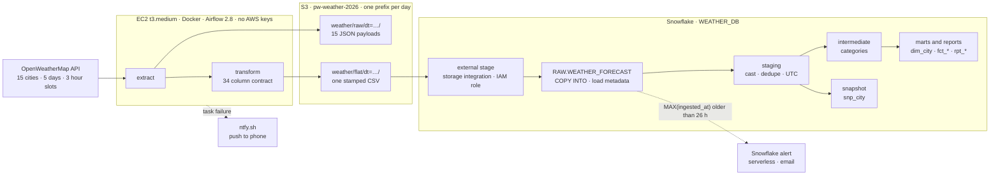
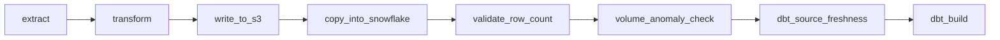

# Weather Data Pipeline

A daily ELT pipeline that pulls the five day forecast for 15 cities from the
OpenWeatherMap API, lands the raw payloads and a flat CSV in S3, loads the
CSV into Snowflake with `COPY INTO` through a storage integration, and builds
analytics models with dbt. Airflow schedules it at 06:00 UTC on a small EC2
instance; nothing of it runs on a laptop. A task failure reaches a phone, and
a run that never happens reaches an inbox.

First unattended run: 2026-10-30, 50 seconds end to end, 600 rows, every
test green. The run log is in [docs/pipeline_runs.md](docs/pipeline_runs.md).

---

## Contents

- [Architecture](#architecture)
- [The DAG](#the-dag)
- [Numbers](#numbers)
- [Decisions](#decisions)
- [Quality and Reliability](#quality-and-reliability)
- [Tech Stack](#tech-stack)
- [dbt Models](#dbt-models)
- [Repository Structure](#repository-structure)
- [Database Schema](#database-schema)
- [Failure Handling](#failure-handling)
- [Testing](#testing)
- [Known Limitations](#known-limitations)
- [Incident Log](#incident-log)
- [Setup](#setup)
- [Running the Pipeline](#running-the-pipeline)
- [dbt](#dbt)
- [Snowflake](#snowflake)
- [Where Postgres Fits](#where-postgres-fits)
- [Sample Output (flat CSV)](#sample-output-flat-csv)

---

## Architecture



The instance writes to S3 through an instance role, Snowflake reads the
bucket through a storage integration and a second IAM role, and the only
secrets on the box are the OpenWeather key, the Snowflake private key, and
Airflow's own. Hosting details, access, and cost are in
[docs/hosting.md](docs/hosting.md).

---

## The DAG

`weather_daily`, schedule `0 6 * * *`, `catchup=False`, one active run at a
time, one hour for the whole run.



| Task | What it does | On failure |
|---|---|---|
| `extract` | 15 API calls with retry and timeout | 2 retries, 5 minutes apart |
| `transform` | Flattens the payloads to the 34 column contract | same |
| `write_to_s3` | Raw JSON per city, then one CSV stamped with lineage columns, under `dt=<data_interval_end>` | same |
| `copy_into_snowflake` | `COPY INTO RAW.WEATHER_FORECAST` from that day's prefix, columns matched by name | same; a retry loads only files the failed attempt did not |
| `validate_row_count` | Fails on zero rows loaded | same |
| `volume_anomaly_check` | Fails if this run loaded under half the 7 run rolling average | same |
| `dbt_source_freshness` | Warn after 26 hours, error after 50 | same |
| `dbt_build` | Six models, one snapshot, 53 tests, in dependency order | no retries: a failing test is a fact, not a flake |

Every task has a 20 minute `execution_timeout`, and every failure that
exhausts its retries calls `on_failure_callback`, which posts to an ntfy.sh
topic. The reasoning behind each setting is in
[docs/airflow_answers.md](docs/airflow_answers.md).

---

## Numbers

From the first unattended run, 2026-10-30 06:00 UTC, read from the task log,
`COPY_HISTORY`, and the bucket:

| | |
|---|---|
| End to end | 50 seconds, 8 tasks, 0 retries |
| Landed in S3 | 15 raw objects (282 KB) and 1 CSV (204 KB) |
| Loaded | 1 file, 600 rows, 0 errors (15 cities by 40 slots) |
| dbt | `PASS=60 WARN=0 ERROR=0 SKIP=0 TOTAL=60` |
| Warehouse time | about 9 s on `LOAD_WH`, 26 s on `TRANSFORM_WH`, both XSMALL |
| Hosting | about $36 a month on a $40 budget |

`RAW.WEATHER_FORECAST` holds 6000 rows across 10 files. Each day's run
re-forecasts most of the slots the previous day covered, so only 1592 of
those rows are distinct `(city_id, dt)` slots; the staging model's
`ROW_NUMBER()` keeps the latest forecast for each.

---

## Decisions

Written down as they were made, with the alternatives:

- [ADR 0001: how a load into RAW.WEATHER_FORECAST stays idempotent](docs/decisions/0001-load-idempotency.md).
  Snowflake's load metadata, not a filename table of our own: `COPY` remembers
  every file it has loaded for 64 days, so an Airflow retry loads only what the
  failed attempt did not, and a retry after success loads nothing. Proven by
  running the loader twice (600 rows, then 0).
- [ADR 0002: the stale data alert runs serverless, outside the box](docs/decisions/0002-stale-data-alert.md).
  The alert for "the run never happened" cannot live on the machine whose
  failure it reports. `RAW.WEATHER_STALE` evaluates in Snowflake at 12:00 UTC
  and emails when `MAX(ingested_at)` is null or older than 26 hours.
- **Raw before transform.** The 15 payloads land in S3 before anything parses
  them, so a transform bug costs a rerun, not a day's data.
- **The run's date is `data_interval_end`, not `ds`.** The 06:00 run on the
  30th is Airflow's run *for* the 29th; the objects belong under the day they
  landed. [docs/airflow_answers.md](docs/airflow_answers.md) has the worked example.
- **No AWS keys on the box.** The instance role carries a policy limited to
  `PutObject` under `weather/*`; the fence was tested with a write to another
  prefix (`AccessDenied`). Snowflake assumes its own read-only role.
- **Two warehouses.** `LOAD_WH` for `COPY`, `TRANSFORM_WH` for dbt, so a slow
  load never contends with a build and each is its own line in cost reporting.
- **Secrets rotated, history kept.** An early commit held keys. They were
  rotated rather than rewritten out of history; the full account is in
  [docs/security.md](docs/security.md), and `gitleaks` runs on every push.

---

## Quality and Reliability

Four gates run in order after the load: a row count check, a volume anomaly
check against the 7 run rolling average, `dbt source freshness` on the raw
table, and dbt tests interleaved with every model build. If one fails, the
run stops there and the phone buzzes.

Every row in the warehouse carries `source_file_name`, `source_file_ts`,
`ingested_at` and `dag_run_id`, enough to trace it to the S3 object and the
Airflow run that produced it. The six models and one snapshot have 53 tests:
52 schema tests (uniqueness, not-null, range, accepted values, referential
integrity, and a custom `is_non_negative` generic) plus a singular test that
`main_temp` sits inside its own `main_temp_min` and `main_temp_max`. 92
pytest unit tests cover the transform, the schema contract, the S3 key
layout, the lineage stamp, the loader's SQL and result parsing, the anomaly
thresholds, and the alert message, and run on every push.

---

## Tech Stack

| Category | Tools |
|---|---|
| Orchestration | Apache Airflow 2.8 (LocalExecutor, Docker Compose) |
| Landing | Amazon S3, IAM (instance role for writes, assumed role for Snowflake reads) |
| Warehouse | Snowflake (storage integration, external stage, `COPY INTO`, serverless alert) |
| Transformation | dbt (dbt-snowflake; dbt-postgres for the local target) |
| Hosting | EC2 `t3.medium`, Ubuntu 24.04, Docker Engine, created from CloudShell by script |
| Language | Python 3.11, SQL |
| Libraries | pandas, boto3, snowflake-connector-python, requests, pytest |
| Alerts | ntfy.sh (task failures), Snowflake `SYSTEM$SEND_EMAIL` (missed runs) |
| CI | GitHub Actions: pytest, gitleaks over the full history |

---

## dbt Models

| Layer | Model | Description |
|---|---|---|
| Staging | `stg_weather__forecast` | Type casting, deterministic deduplication, UTC normalization |
| Snapshot | `snp_city` | Type 2 history of city name and population, keyed on `city_id` |
| Intermediate | `int_weather_enriched` | Derived temp, wind, and precipitation categories |
| Mart | `dim_city` | City dimension, one row per city |
| Mart | `fct_weather_forecast` | Incremental 3 hour forecast fact table, merge on `(city_id, local_dt)` |
| Mart | `fct_weather_daily` | Daily aggregate (avg/min/max temp, precipitation totals) |
| Report | `rpt_current_conditions` | Current conditions view, one row per city |

Generic tests are declared in each layer's `schema.yml`; `dbt/tests/` holds
the singular test `assert_temp_within_min_max.sql` and the custom generic
`is_non_negative`.


---

## Repository Structure

```
weather_pipeline/
├── .github/workflows/ci.yml       # pytest on 3.11, gitleaks over the full history
├── dags/
│   └── weather_daily.py           # the DAG: eight tasks, retries, timeouts, failure callback
├── src/
│   ├── client.py                  # OpenWeatherMap API client
│   ├── extract.py                 # calls the API, returns the raw payloads
│   ├── transform.py               # flattens payloads to the 34 column contract
│   ├── schema.py                  # the contract: columns, order, dtypes
│   ├── load.py                    # CSV writer, file naming, lineage stamp
│   ├── s3.py                      # key layout weather/{raw|flat}/dt=.../ and one upload function
│   ├── landing.py                 # S3 client from the environment, raw and flat uploads
│   ├── snowflake_loader.py        # COPY INTO for one partition, LoadResult, CLI with --dt
│   ├── quality_checks.py          # volume anomaly check against the rolling average
│   ├── alerts.py                  # failure message and the ntfy post
│   ├── postgres_loader.py         # the Postgres path, see Where Postgres Fits
│   ├── main.py                    # CLI: extract, land in S3, write CSV, load Postgres
│   ├── logging_config.py
│   └── utils.py
├── tests/                         # 92 pytest tests, nine files, fakes for S3 and Snowflake
├── dbt/
│   ├── models/{staging,intermediate,marts,reports}/
│   ├── snapshots/snp_city.sql
│   ├── tests/                     # singular test and the is_non_negative generic
│   ├── macros/generate_schema_name.sql
│   ├── profiles.yml               # dev and prod (Postgres), snowflake
│   ├── dbt_project.yml
│   └── packages.yml
├── setup/                         # Snowflake, run once in order; see the Snowflake section
│   ├── 00_account.sql … 05_raw_tables.sql
│   ├── 06_stage.sql               # file formats, the external stage on S3
│   ├── 07_storage_integration.sql # S3_WEATHER_INT and the IAM handshake
│   ├── 08_s3_stage.sql            # CSV_PARSE_HEADER and the flat stage the loader reads
│   └── 09_alerts.sql              # email integration and RAW.WEATHER_STALE
├── infra/
│   ├── iam/                       # the three policies: extractor write, Snowflake read, its trust
│   └── ec2/                       # create_box.sh (CloudShell) and bootstrap_box.sh (on the box)
├── docs/
│   ├── pipeline_runs.md           # every load, with what COPY returned
│   ├── decisions/                 # ADRs
│   ├── airflow_answers.md         # why each DAG setting is what it is
│   ├── hosting.md                 # the box: access, credentials, cost, review date
│   ├── security.md                # the secret scan and the rotation
│   ├── sprint_notes.md            # the build, day by day
│   └── dbt_lineage.png
├── data/raw/                      # CSVs from CLI runs; gitignored
├── keys/README.md                 # how to generate the Snowflake key pair; the keys are not committed
├── docker-compose.yml             # scheduler, webserver, Airflow metadata DB, the local Postgres warehouse
├── Dockerfile
├── Makefile
├── requirements.txt               # the venv and CI; regenerated from a clean venv
├── requirements-airflow.txt       # what the image installs
└── .env.example                   # every variable the stack reads, with none of the values
```

---

## Database Schema

### RAW.WEATHER_FORECAST

Loaded by `COPY INTO` from the flat CSV, columns matched by name
(`MATCH_BY_COLUMN_NAME = CASE_INSENSITIVE`, so the CSV's column order does
not matter but its names do). The 34 API columns are fixed by the contract
in `src/schema.py`, so the shape does not change with the weather. Types are
from `setup/05_raw_tables.sql`.

| Column | Type | Description |
|---|---|---|
| dt | NUMBER | Forecast Unix timestamp |
| dt_txt | VARCHAR | Forecast timestamp as text |
| main_temp | FLOAT | Temperature (°F) |
| main_feels_like | FLOAT | Feels-like temperature |
| main_temp_min / max | FLOAT | Min/max temperature |
| main_temp_kf | FLOAT | Internal temperature adjustment from the API |
| main_dew_point | FLOAT | Dew point |
| main_humidity | NUMBER | Humidity % |
| main_pressure | NUMBER | Atmospheric pressure |
| main_sea_level / grnd_level | NUMBER | Pressure at sea and ground level |
| wind_speed | FLOAT | Wind speed |
| wind_deg | NUMBER | Wind direction (degrees) |
| wind_gust | FLOAT | Wind gust speed |
| rain_3h | FLOAT | Rain volume (last 3 hours), null when no rain |
| snow_3h | FLOAT | Snow volume (last 3 hours), null when no snow |
| clouds_all | NUMBER | Cloud coverage % |
| visibility | NUMBER | Visibility distance |
| pop | FLOAT | Probability of precipitation (0-1) |
| sys_pod | VARCHAR | Part of day indicator (d / n) |
| weather_id | NUMBER | Weather condition ID |
| weather_main | VARCHAR | High-level condition (Rain, Clouds, etc.) |
| weather_description | VARCHAR | Detailed condition |
| weather_icon | VARCHAR | Icon code |
| city_id | NUMBER | City identifier |
| city_name | VARCHAR | City name |
| city_country | VARCHAR | Country code |
| city_population | NUMBER | City population |
| city_timezone | NUMBER | UTC offset in seconds |
| city_sunrise / sunset | NUMBER | Sunrise/sunset Unix timestamps |
| city_coord_lat / lon | FLOAT | Coordinates |
| source_file_name | VARCHAR | The CSV's file name, the key `COPY` remembers |
| source_file_ts | TIMESTAMP_NTZ | The run timestamp the file name carries |
| ingested_at | TIMESTAMP_NTZ | UTC time of the run |
| dag_run_id | VARCHAR | Airflow run id |

The last four are lineage, stamped on the frame before it is written, so the
CSV in S3 and the rows in the table say the same thing.

### STAGING.stg_weather__forecast
Casts every column, normalizes timestamps to UTC, trims strings, and
deduplicates to one row per `city_id` + `dt_utc`. The winner is chosen by
`ROW_NUMBER()` ordered by `ingested_at DESC NULLS LAST`, then
`source_file_name DESC`, so two builds over the same raw data always pick the
same row. A `tie_count` column records how many rows shared the winning
`ingested_at`; anything above 1 means the tie-breaker had to decide.

### SNAPSHOTS.snp_city
dbt snapshot with `strategy='check'` on `city_name` and `city_population`,
keyed on `city_id`. Each change closes the previous row with `dbt_valid_to`
and opens a new one: a type 2 history of the city metadata the API returns.

### INTERMEDIATE.int_weather_enriched
Adds `temp_category` (freezing / cold / mild / warm / hot), `wind_category`
(calm / light / moderate / strong / storm), and `precip_type` (none / rain /
snow / rain_and_snow) on top of staging.

### ANALYTICS.dim_city
One row per city, deduplicated with `ROW_NUMBER()` ordered by most recent forecast.

### ANALYTICS.fct_weather_forecast
Incremental 3 hour forecast fact, `incremental_strategy='merge'` on
`(city_id, local_dt)`. Each build takes staging rows whose `ingested_at` is at
or after the newest one already in the table and merges them: existing keys
are updated, new keys inserted. Staging picks one winner per slot from
everything in raw; the merge reconciles that winner with what a previous
build stored, so a forecast the API later revises replaces its earlier row.

### ANALYTICS.fct_weather_daily
One row per `city_id` + calendar date: avg/min/max temp, avg humidity, avg
wind speed, total rain and snow.

### REPORTS.rpt_current_conditions
The single most recent forecast per city with the enriched columns. Ready for
a BI tool.

---

## Failure Handling

The pipeline fails at the point of failure, says so on a phone, and never
passes bad data downstream.

**API or network failure.** `extract` raises on a non-200 or a timeout;
Airflow retries twice, five minutes apart, then fails the run and the
callback posts to ntfy. To simulate: set `OPENWEATHER_API_KEY=invalid` in
`.env`, restart, trigger.

**Transform failure.** Proven on 2026-10-29: `transform` was made to raise,
failed three times, the run went `failed`, the phone received the message.
Then only `transform` was cleared with `--downstream`, so the repaired task
and everything after it re-ran while `extract` kept its one attempt: one API
call, one `COPY`. The log is in `docs/pipeline_runs.md`.

**Timeouts.** A task that hangs (an API call that never returns, a Snowflake
login that stalls) is killed at 20 minutes and retried; a run still going at
one hour is failed so tomorrow's is not blocked.

**Volume anomaly.** `volume_anomaly_check` compares this run's row count with
the 7 run rolling average and fails below half of it; the message names the
`dag_run_id`. Skipped with fewer than 3 prior runs. To simulate: set
`ANOMALY_THRESHOLD_RATIO = 1.1` in `src/quality_checks.py`, trigger, restore.

**Source freshness.** `dbt source freshness` checks `MAX(ingested_at)` on the
raw table: warn after 26 hours, error after 50, so models are never rebuilt
on a table that stopped receiving data. To simulate: set
`error_after: {count: 1, period: minute}` in `weather_sources.yml`, run
`make dbt-fresh`, restore.

**Data quality.** `dbt build` runs and tests each model in dependency order,
so a failing test on staging stops the marts from being built on data known
to be bad. To simulate in Snowflake:
`UPDATE RAW.WEATHER_FORECAST SET weather_id = NULL WHERE city_id = 5128581;`
then trigger; `dbt_build` fails on `not_null` for `weather_id`. Restore with
`UPDATE RAW.WEATHER_FORECAST SET weather_id = 500 WHERE weather_id IS NULL;`.

**The run that never happens.** None of the above fires when the box is down
or the scheduler is wedged, which is why `RAW.WEATHER_STALE` evaluates in
Snowflake, not on the box, every day at 12:00 UTC. Proven by setting the
threshold to the future and waiting for the email (ADR 0002).

---

## Testing

The suite runs outside Docker. `venv/` is gitignored, so a fresh clone needs one:

```bash
python3 -m venv venv
source venv/bin/activate
pip install -r requirements.txt
python -m pytest tests/ -v
```

92 tests across nine files:

- `test_transform.py`: `validate_response` and `transform_records` (shape, missing fields, row count, city broadcast, bad dates, weather field flattening)
- `test_schema.py`: the column and dtype contract (absent optional fields filled with nulls, unknown fields dropped, stable order, integer rendering under null promotion)
- `test_s3.py`: the key layout is pure and date-partitioned, `upload_bytes` passes the right arguments
- `test_landing.py`: raw payloads land one per city, the flat CSV lands under the run's `dt`, missing settings fail loudly (a fake S3 client in `conftest.py`)
- `test_load.py`: atomic CSV writes, the lineage stamp (columns last, re-stamp replaces), and the CSV header against the columns in `setup/05_raw_tables.sql`
- `test_snowflake_loader.py`: the `COPY` statement, the stage path validates its date, the result is read by column name, the zero file case, connection errors wrapped as `LoadError` (a fake cursor and connection)
- `test_quality_checks.py`: the anomaly thresholds, the boundary, the insufficient-history skip, an empty warehouse
- `test_alerts.py`: the message text and that a failed post never raises
- `test_postgres_loader.py`: `parse_source_file_ts` and the load result format

CI (`.github/workflows/ci.yml`) runs the suite on Python 3.11 and `gitleaks`
over the full git history on every push and pull request to `master`.

---

## Known Limitations

**The frame crosses XCom.** `transform` returns the 600 row frame and
`write_to_s3` receives it through XCom, which is fine at this size and wrong
at a larger one. The planned fix is a `weather extract --dt` CLI that each
task calls, with S3 as the only hand-off.

**One box, no Elastic IP.** A stop and start changes the public IP and the
security group rule has to follow. The instance is a pet by design for now;
Terraform for the bucket, roles and instance is on the list.

**Conditionally absent API fields.** The API omits optional keys rather
than sending nulls (`snow_3h` only when some city has snow). `src/schema.py`
reindexes every frame to a fixed 34 column list, filling absent columns with
nulls and dropping unrecognized ones with a warning, and pins dtypes so a
null never turns an integer column into `10000.0`. Adding a genuinely new API
field is a one line change to `FORECAST_COLUMNS` plus an `ALTER TABLE`.

**Pinned dbt and provider versions.** `requirements-airflow.txt` pins
`dbt-core` and the adapters to match `requirements.txt` exactly, and the
`Dockerfile` installs `apache-airflow-providers-postgres==5.10.0` in its own
step. Unpinned, a fresh build resolved a provider built for Airflow 3 and a
dbt too old for the `arguments:` test syntax. See the comments in both files.

---

## Incident Log

> Entries describe the pipeline as it was at the time. The separate
> `dbt_run` and `dbt_test` tasks were later consolidated into `dbt_build`,
> and the Postgres load task was replaced by the S3 to Snowflake path.

### June 2026: cascading failure from a schema change and a backfill

Three consecutive runs failed at `load_raw_table` because the API began
returning `main_dew_point`, a column the Postgres raw table did not have.
`ALTER TABLE` added it and the loader learned to drop unknown columns with a
warning. The backfill of the three missed CSVs then picked up older files from
before city columns existed, contributing 320 rows with null `city_id`. The
`not_null` test on `city_id` caught them before the mart was touched. The rows
were patched in place from valid rows with matching structure; the CSVs were
left as the record of what the API returned.

### September 2026: porting the dbt project to Snowflake

The first `dbt run --target snowflake` against the freshly scripted account
failed three times, each for a different reason. One: `WEATHER_ENGINEER`
cannot create schemas, and `02_database.sql` had created `MARTS` where the
project expected `ANALYTICS`, `INTERMEDIATE` and `REPORTS`; the script was
fixed and the restriction kept, because it is what surfaced the drift. Two:
`now()` in `rpt_current_conditions`, replaced with `{{ dbt.current_timestamp() }}`.
Three: `EXTRACT(EPOCH FROM ...)` in the same model, replaced with
`{{ dbt.datediff(...) }}`. All six models and the test suite pass on both
targets from the same SQL; the only `target.type` check in the project is the
source schema name (`RAW` versus `raw`).

### October 2026: secrets in history

A `gitleaks` scan of the full history found an API key, an Airflow Fernet key
and a webserver secret in early commits. All three were rotated, the
`airflow.cfg` that carried two of them was removed from tracking, the history
was kept, and `gitleaks` was added to CI with the three fingerprints in
`.gitleaksignore`. The account is in [docs/security.md](docs/security.md).

---

## Setup

Three accounts, in this order: an OpenWeatherMap API key (free tier), an AWS
account, a Snowflake account in the same AWS region as the bucket.

### AWS

1. A bucket with public access blocked and default encryption, in one
   region (this project uses `us-east-2`, which is where the Snowflake
   account lives too).
2. A writer: `infra/iam/extractor_write_policy.json` (`PutObject` under
   `weather/*`, `ListBucket` on that prefix). For a laptop, attach it to an
   IAM user and put the keys in `.env`; for EC2, attach it to an instance role
   and put nothing in `.env`.
3. A reader for Snowflake: `infra/iam/snowflake_read_policy.json` on a role
   whose trust policy is `infra/iam/snowflake_read_trust_policy.json`. The two
   placeholders in the trust policy are filled from `DESC INTEGRATION` after
   step 4 below; the handshake is described in `setup/07_storage_integration.sql`.
4. Optional, for hosting: `infra/ec2/create_box.sh` from CloudShell creates
   the budget, key pair, instance role, security group and instance;
   `infra/ec2/bootstrap_box.sh` on the box installs Docker and clones the
   repo. Secrets go over by `scp`. See [docs/hosting.md](docs/hosting.md).

### Snowflake

Run `setup/00_account.sql` through `09_alerts.sql` in order, each under the
role its header names. The [Snowflake](#snowflake) section lists what each
one does. Generate the key pair with the two commands in `keys/README.md` and
paste the public half into `04_service_user.sql` before running it.

### Environment

```bash
cp .env.example .env
```

`.env.example` lists every variable the stack reads with a comment on each:
the API key, the Airflow secrets (generate each one fresh), the Snowflake
account, user, role, warehouses, database and private key path, the AWS
region and bucket (and keys, only off EC2), the Airflow UI password, and the
ntfy topic. Set `AIRFLOW_UID` to your UID (`id -u`) so files the containers
write are yours.

### Start Airflow

```bash
docker compose up -d
docker compose ps                                                     # every service healthy
docker compose exec airflow-scheduler airflow dags unpause weather_daily
```

The UI is at `http://localhost:8080` (`admin` and `AIRFLOW_WWW_PASSWORD`).
Every DAG is paused at creation, so nothing runs until it is unpaused.
Unpausing with `catchup=False` still runs the most recent completed interval
once, which is a useful first run.

---

## Running the Pipeline

```bash
make trigger          # one run now (lands in yesterday's dt= before 06:00 UTC, see airflow_answers.md)
make runs             # every run with its state
make load DT=2026-10-30   # COPY one partition by hand; a repeat loads nothing
make logs             # tail the scheduler
```

The loader also runs from a venv on the laptop: `python -m src.snowflake_loader --dt 2026-10-30`.

`python -m src.main` is the CLI path: extract, land raw and flat in S3, write
the CSV to `data/raw/`, load Postgres. It needs the S3 settings and is kept
for the local Postgres target; the DAG does not use it.

---

## dbt

dbt runs inside the DAG. To run it from the host against Snowflake:

```bash
source venv/bin/activate
set -a; source .env; set +a        # from the repo root
cd dbt
dbt deps
dbt build --target snowflake
```

### Which profiles.yml dbt uses

dbt picks exactly one `profiles.yml`: the `--profiles-dir` flag, then
`DBT_PROFILES_DIR`, then the current directory, then `~/.dbt/`. The DAG and
the `Makefile` pass `--profiles-dir /opt/airflow/dbt`; from the host, `cd dbt`
makes the project's own file win. `dbt build` runs and tests each model in
dependency order, which is why the DAG uses it rather than `run` then `test`.

### Targets

`DBT_TARGET` picks the target: `snowflake` (what `docker-compose.yml` sets
for the DAG), or `dev` and `prod` for Postgres. Differences between the two
databases are handled with `target.type` checks and dbt's cross-database
macros, not duplicate SQL.

To regenerate the lineage graph: `dbt docs generate` inside the container.

---

## Snowflake

Everything needed to stand the account up is in `setup/`, numbered in the
order it has to run:

| Script | Role | What it does |
|---|---|---|
| `00_account.sql` | ACCOUNTADMIN | Account timezone UTC, `TRIAL_GUARD` resource monitor |
| `01_warehouses.sql` | SYSADMIN | `LOAD_WH` for `COPY INTO` and `TRANSFORM_WH` for dbt, both XSMALL with auto-suspend |
| `02_database.sql` | SYSADMIN | `WEATHER_DB` with `RAW`, `STAGING`, `INTERMEDIATE`, `ANALYTICS` and `REPORTS`; drops `PUBLIC` |
| `03_roles_and_grants.sql` | USERADMIN / SECURITYADMIN / SYSADMIN | `WEATHER_ENGINEER`: usage on both warehouses, create table and view on every schema, future grants on `RAW` |
| `04_service_user.sql` | USERADMIN | `WEATHER_SVC`, `TYPE = SERVICE`, key-pair auth, no password |
| `05_raw_tables.sql` | WEATHER_ENGINEER | `RAW.WEATHER_FORECAST` |
| `06_stage.sql` | WEATHER_ENGINEER | `CSV_HEADER` and `JSON_FORMAT` file formats; `S3_WEATHER_STAGE` on the integration |
| `07_storage_integration.sql` | ACCOUNTADMIN | `S3_WEATHER_INT`: the role ARN, the `DESC INTEGRATION` values that go into the IAM trust policy, and why the integration is only ever `ALTER`ed |
| `08_s3_stage.sql` | WEATHER_ENGINEER | `CSV_PARSE_HEADER` (header parsed, columns matched by name) and `S3_FLAT_STAGE` at `weather/flat/`, which the loader reads |
| `09_alerts.sql` | ACCOUNTADMIN / WEATHER_ENGINEER | `WEATHER_EMAIL_INT`, the grants, and `RAW.WEATHER_STALE` |

The service user has no password, so the only way in as it is the private
key, which is never committed. `keys/README.md` has the two `openssl`
commands; `docker-compose.yml` mounts `keys/` read-only into the containers.

The loader (`src/snowflake_loader.py`) runs one statement:

```sql
COPY INTO RAW.WEATHER_FORECAST
FROM @RAW.S3_FLAT_STAGE/dt=2026-10-30/
FILE_FORMAT = (FORMAT_NAME = RAW.CSV_PARSE_HEADER)
MATCH_BY_COLUMN_NAME = CASE_INSENSITIVE
ON_ERROR = ABORT_STATEMENT;
```

and reads `files_loaded`, `rows_loaded`, `rows_parsed` and `errors_seen`
from the result by column name. `VALIDATION_MODE` cannot be combined with
`MATCH_BY_COLUMN_NAME`, so a dry run uses the positional `CSV_HEADER` format;
ADR 0001 has the command.

---

## Where Postgres Fits

The pipeline ran on a Postgres warehouse in the same Docker stack from
February to October 2026, with `pandas.to_sql` as the loader and a filename
table as the idempotency key. That is the pipeline the June incident
describes. In October the load moved to S3 and Snowflake, and Postgres left
the DAG's path.

What remains, on purpose, until the package rewrite: the `postgres-warehouse`
service in `docker-compose.yml`, `src/postgres_loader.py` and its test, the
Postgres load at the end of `src/main.py`, and the `dev` and `prod` targets in
`dbt/profiles.yml`. Together they let the dbt project run against a local
Postgres with no cloud accounts, which is still a useful way to read the SQL.

---

## Sample Output (flat CSV)

One CSV per run, named `output_YYYYMMDD_HHMMSS_ffffff.csv` from the run's
UTC timestamp (the microseconds keep two runs in the same second apart),
stamped with the four lineage columns last, and landed under
`weather/flat/dt=YYYY-MM-DD/`. The 15 raw payloads land beside it under
`weather/raw/dt=YYYY-MM-DD/` as `<city_id>_<same timestamp>.json`, so one
timestamp ties a run's 16 objects together.

```
dt,visibility,pop,dt_txt,main_temp,main_feels_like,main_temp_min,main_temp_max,main_pressure,main_sea_level,main_grnd_level,main_humidity,main_temp_kf,main_dew_point,clouds_all,wind_speed,wind_deg,wind_gust,sys_pod,rain_3h,snow_3h,city_id,...,source_file_name,source_file_ts,ingested_at,dag_run_id
1793350800,10000,0.0,2026-10-30 09:00:00,57.36,56.84,55.85,57.36,1018,1018,1013,86,0.84,53.22,29,6.29,250,11.97,n,,,5128581,...,output_20261030_060007_746681.csv,2026-10-30 06:00:07.746681,2026-10-30 06:00:07.746681,scheduled__2026-10-29T06:00:00+00:00
```

The two empty fields before `city_id` are `rain_3h` and `snow_3h`, absent
from the payload on a dry day and filled with nulls rather than dropped.
